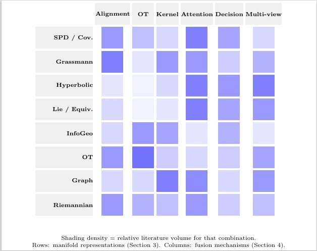
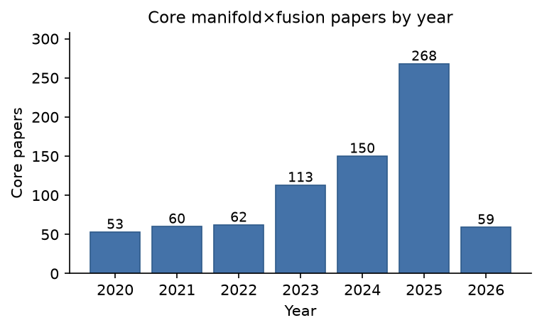

# Supplementary Material — Venue List and Search Scope

**Manuscript:** *under submission*

**Why this file exists:** the report list the literature search of section 1.5 but cannot print
the complete list of journal and conference names inline — the full names alone occupy more than a
page. The complete venue list is therefore hosted here as supplementary material.

--

## 1. Search period and scope

- **Period:** 2020–2026 (the 2026 window is partial; closing date: `<Aug. 1>`).
- **Sources:** peer-reviewed journal articles and top-tier conference papers.
- **Record types:** titles, abstracts, and author keywords, screened against controlled
  vocabularies (section 1.5 of the manuscript).

## 2. Venues searched and venues contributing papers

**56 venues were searched: 50 journals and 6 conferences** (period 2020–2026).
Of these, **46 venues contributed papers to the fusion-related screening pool**
(828 papers): 40 journals (404 papers) and 6 conferences (424 papers); a further
10 searched journals returned no paper that passed fusion-relevance screening
(see the record-level tables released with the code).

### 2.1 Journals contributing to the pool (40)

| # | Abbreviation | Full name | Papers in pool |
|---|--------------|-----------|----------------|
| 1 | TGRS | IEEE Transactions on Geoscience and Remote Sensing | 38 |
| 2 | TPAMI | IEEE Transactions on Pattern Analysis and Machine Intelligence | 34 |
| 3 | TNNLS | IEEE Transactions on Neural Networks and Learning Systems | 33 |
| 4 | TIP | IEEE Transactions on Image Processing | 30 |
| 5 | InfoFusion | Information Fusion | 27 |
| 6 | JSTARS | IEEE Journal of Selected Topics in Applied Earth Observations and Remote Sensing | 22 |
| 7 | JBHI | IEEE Journal of Biomedical and Health Informatics | 21 |
| 8 | TSP | IEEE Transactions on Signal Processing | 19 |
| 9 | TCYB | IEEE Transactions on Cybernetics | 18 |
| 10 | TMI | IEEE Transactions on Medical Imaging | 17 |
| 11 | GRSL | IEEE Geoscience and Remote Sensing Letters | 16 |
| 12 | TITS | IEEE Transactions on Intelligent Transportation Systems | 14 |
| 13 | TKDE | IEEE Transactions on Knowledge and Data Engineering | 14 |
| 14 | TRO | IEEE Transactions on Robotics | 10 |
| 15 | TOG | ACM Transactions on Graphics | 8 |
| 16 | TOMM | ACM Transactions on Multimedia Computing, Communications, and Applications | 8 |
| 17 | CEA | Computers and Electronics in Agriculture | 7 |
| 18 | MedIA | Medical Image Analysis | 6 |
| 19 | TASLP | IEEE/ACM Transactions on Audio, Speech, and Language Processing | 6 |
| 20 | TAC | IEEE Transactions on Automatic Control | 6 |
| 21 | TVCG | IEEE Transactions on Visualization and Computer Graphics | 5 |
| 22 | IJCV | International Journal of Computer Vision | 5 |
| 23 | TAI | IEEE Transactions on Artificial Intelligence | 5 |
| 24 | TFS | IEEE Transactions on Fuzzy Systems | 5 |
| 25 | TBME | IEEE Transactions on Biomedical Engineering | 5 |
| 26 | SPM | IEEE Signal Processing Magazine | 4 |
| 27 | TPWRS | IEEE Transactions on Power Systems | 3 |
| 28 | TBIOM | IEEE Transactions on Biometrics, Behavior, and Identity Science | 3 |
| 29 | AIReview | Artificial Intelligence Review | 2 |
| 30 | TIST | ACM Transactions on Intelligent Systems and Technology | 2 |
| 31 | CL | Computational Linguistics | 2 |
| 32 | AI | Artificial Intelligence (Elsevier) | 1 |
| 33 | IJRR | The International Journal of Robotics Research | 1 |
| 34 | Automatica | Automatica (Elsevier) | 1 |
| 35 | ProcIEEE | Proceedings of the IEEE | 1 |
| 36 | NatMI | Nature Machine Intelligence | 1 |
| 37 | JMLR | Journal of Machine Learning Research | 1 |
| 38 | JFR | Journal of Field Robotics | 1 |
| 39 | MLJ | Machine Learning (Springer) | 1 |
| 40 | TKDD | ACM Transactions on Knowledge Discovery from Data | 1 |
| | **Total** | | **404** |

### 2.2 Conferences (6)

| # | Abbreviation | Full name | Papers in pool |
|---|--------------|-----------|----------------|
| 1 | NeurIPS | Conference on Neural Information Processing Systems | 159 |
| 2 | ICLR | International Conference on Learning Representations | 91 |
| 3 | ICML | International Conference on Machine Learning | 89 |
| 4 | CVPR | IEEE/CVF Conference on Computer Vision and Pattern Recognition | 51 |
| 5 | IJCAI | International Joint Conference on Artificial Intelligence | 30 |
| 6 | ICCV | IEEE/CVF International Conference on Computer Vision | 4 |
| | **Total** | | **424** |

## 3. Venues excluded before the search

| Venue | Type | Reason |
|-------|------|--------|
| Scientific Reports | Journal | Broad multidisciplinary scope; excluded for scale |
| Nature Communications | Journal | Broad multidisciplinary scope; excluded for scale |
| ECCV (European Conference on Computer Vision) | Conference | No usable metadata for the target period |
| AAAI (Conference on Artificial Intelligence) | Conference | No usable metadata for the target period |

These four venues never contributed to any count reported in the manuscript.

## 4. Screening stages (mirrors Fig. 1 of the manuscript)

| Stage | Result |
|-------|--------|
| 1. Venue and period selection | 56 venues searched (50 journals + 6 conferences); 46 contributed to the pool (40 journals + 6 conferences, see §2). Provenance only. |
| 2. Fusion-screened pool (reproducible starting point) | **828** fusion-screened papers (404 journal / 424 conference), released as a record table with three-axis labels |
| 3. Scope filter | 63 removed (dimensionality-reduction-only work and methods that only concatenate features in Euclidean space) → **765** core manifold×fusion papers (345 journal / 420 conference); reproduced by the `dimred_only` column |
| 4. Three-axis labelling | one primary label per axis (representation × mechanism × application) |
| 5. Representative selection | 731 group assignments → **432 unique representative works**, of which 200+ are cited in the bibliography |

## 5. Data and code availability

The screening pipeline is implemented in Python: controlled-vocabulary keyword extraction over
titles, abstracts, and keywords; de-duplication; scope filtering; three-axis labelling; citation
and venue scoring; and generation of the corpus figures. The complete code, together with the
record-level screening tables needed to reproduce every count in the manuscript, will be
publicly released in this repository upon acceptance of the manuscript. A copy can be provided to
the editors and reviewers on request before publication.

## 6. Representation family focus
Figure 1 summarizes, over the labelled subset, which operation is most heavily used within each representation family.

Figure 2 shows, Year-wise distribution of the core manifold$\times$fusion corpus (765 papers). The 2026 window is partial and ends on the search closing date (Aug. 1); the seventh application domain, agriculture, is documented from works collected outside the corpus (section~3(i)) and is not plotted.

## 7. Tables. Applications of Manifold Methods and Geometric Information Fusion Across Domains

Our comprehensive survey includes specialized reference tables detailing data modalities, manifold representations, and learning mechanisms across various domains: [Clinical Healthcare & 3D Geometry](#), [NLP & Video Temporal Analysis](#), and [Remote Sensing & Precision Agriculture](#). These appendices outline foundational domain contexts, mapping how specific representation families map to specialized real-world applications.
Comprehensive taxonomies detailing data characteristics, geometric representations and modeling frameworks, and learning and fusion mechanisms across the surveyed domains (including healthcare, 3D vision, language and multimodal learning, video, remote sensing, robotics, and agriculture) are compiled here and also mentioned in Section 5.

| Application domain | Data characteristics and geometric motivation | Geometric representation | Fusion strategy and level | Applications and evaluation |
|---|---|---|---|---|
| **Healthcare and biometrics** | EEG and image-set covariance matrices have symmetric positive-definite structure; orthogonality matters for transformations. | SPD / Riemannian / Stiefel [fang2022, yamamoto2023, wang2024a, tibermacine2026] | *Covariance/feature level.* Tangent-space mapping, covariance aggregation, Riemannian metric learning, and orthogonal transformations | Preserves covariance geometry and improves EEG/BCI decoding and covariance-based image-set discrimination. *Suggested evaluation:* Subject-held-out EEG/BCI accuracy and image-set classification against Euclidean baselines. |
| **Healthcare and biometrics** | Connectomes, imaging–genetics relations, and incomplete diagnostic modalities exhibit higher-order and graph dependencies. | Graph / Hypergraph Manifolds [zhang2022a, jiao2023, chang2026] | *Graph/relational feature level.* Graph construction, manifold regularization, relational propagation, and hypergraph alignment | Supports imaging–genetics integration, incomplete ultrasound diagnosis, and cross-atlas connectome remapping. *Suggested evaluation:* Patient/atlas-held-out diagnostic performance versus graph-free models. |
| **Healthcare and biometrics** | Undersampled MRI and pathology imagery contain nonlinear, lower-dimensional latent structure. | Latent Manifold Learning [zou2022, huang2024] | *Latent representation; multi-source fusion not established.* Nonlinear manifold embedding and geometry-constrained latent representation learning | Enables reconstruction from undersampled MRI and discriminative pathology representation learning. *Suggested evaluation:* Reconstruction error and pathology discrimination versus unconstrained latent models. |
| **Healthcare and biometrics** | Differences between sites, identities, and imaging modalities produce mismatched feature distributions. | Optimal Transport / Wasserstein [fu2023, ding2023, wang2024b, yang2025, hu2026, chen2026, zhang2026] | *Distribution/cross-modal alignment.* Distribution matching, cross-modal transport, modality alignment, and prototype transport | Reduces domain and modality discrepancies in diagnosis, reconstruction, segmentation, and person re-identification. *Suggested evaluation:* Cross-site diagnostic accuracy, segmentation, or re-identification with an OT ablation. |
| **Healthcare and biometrics** | Brain connectivity is relational and hierarchical, while neuroimaging distributions differ across sites. | Hyperbolic Geometry [yang2025b, luo2025] | *Graph/feature alignment.* Hyperbolic graph aggregation and cross-domain alignment in negatively curved spaces | Preserves hierarchical brain-network structure and improves multi-site neuroimaging analysis. *Suggested evaluation:* Site-held-out neuroimaging results versus Euclidean graph embeddings. |
| **Remote sensing and HSI** | Hyperspectral data have coupled spatial–spectral neighborhoods and cross-domain distribution shifts. | Manifold / Distribution Alignment [hong2020, dong2020, wang2026nash] | *Spatial–spectral feature alignment.* Spatial–spectral manifold alignment, kernel embedding, distribution matching, and cross-scale alignment | Preserves spatial–spectral structures, reduces domain discrepancy, and improves semantic segmentation. *Suggested evaluation:* Cross-domain segmentation accuracy with and without alignment. |
| **Remote sensing and HSI** | PolSAR polarimetric and texture views share neighborhood structure but carry complementary cues. | Manifold Regularization [huang2021b] | *Within- and across-view feature selection.* Multi-view sparse feature selection constrained by intrinsic manifold geometry | Preserves local structure while selecting complementary polarimetric and texture features for PolSAR classification. *Suggested evaluation:* PolSAR classification accuracy with and without manifold regularization. |
| **Remote sensing and HSI** | HSI, MSI, and panchromatic sensors differ in spatial and spectral resolution. | Spatial–Spectral Structure [dian2023, yuan2024, wang2024d] | *Image/pixel and spatial–spectral feature levels.* Zero-shot fusion, coupled spatial–spectral deep priors, and Tucker decomposition with manifold learning | Supports HSI sharpening, super-resolution, and blind HSI–MSI fusion. *Suggested evaluation:* Spectral distortion and spatial fidelity versus non-geometric sensor fusion. |
| **Remote sensing and HSI** | Optical and SAR observations carry complementary information but have a substantial modality gap. | Cross-Modal Feature Fusion [han2025] | *Cross-sensor feature level.* Difference-complementary learning between optical and SAR representations | Exploits complementary sensor information for semi-supervised remote-sensing segmentation. *Suggested evaluation:* Segmentation mIoU versus optical-only, SAR-only, and no-alignment controls. |
| **Remote sensing and HSI** | Dual-sensor spectral and panchromatic observations require transformation-consistent integration. | Equivariant Spatial–Spectral Geometry [wang2026a, dian2026] | *Sensor/image level.* Equivariant dual-sensor fusion and Bayesian variational integration of spectral and PAN observations | Produces high-resolution hyperspectral imagery while reducing spatial and spectral distortion. *Suggested evaluation:* Spectral-angle error and spatial fidelity versus non-equivariant fusion. |
| **Remote sensing and HSI** | Remote-sensing visual details and textual descriptions must be aligned across scales. | Optimal-Transport Geometry [zhang2026a] | *Visual–semantic feature level.* Scale-aware representation learning with optimal-transport visual–semantic alignment | Aligns multi-scale visual features with textual semantics for remote-sensing image captioning. *Suggested evaluation:* Image-caption quality and ablation of optimal-transport matching. |
| **Video and temporal data** | Object tracking experiences appearance changes and uncertainty across time. | Manifold-Aware Ensemble [wang2021a] | *Decision/ensemble level.* Diverse representation learning and ensemble prediction fusion | Improves representation diversity and robustness for visual object tracking. *Suggested evaluation:* Tracking precision and robustness with versus without ensemble fusion. |
| **Video and temporal data** | Adjacent video frames are correlated, and motion must remain consistent between frames. | Contextual Temporal Representation [li2022context] | *Sequential feature level.* Self-similarity context fusion with inter-frame motion information | Improves temporal consistency and enables high-frame-rate video interpolation. *Suggested evaluation:* Interpolation quality and temporal consistency under large motion. |
| **Video and temporal data** | Regular and irregularly sampled time series can follow nonlinear trajectories. | SPD / Riemannian Temporal Geometry [jeong2023] | *Temporal representation; multi-source fusion not established.* Continuous nonlinear manifold learning for regular and irregular temporal data | Captures nonlinear dynamics for geometry-aware time-series modeling. *Suggested evaluation:* Forecast error on irregular sampling against Euclidean temporal models. |
| **Video and temporal data** | Long-horizon fluid and temporal dynamics contain multi-scale evolution. | Neural Flow-Map Representation [deng2023] | *Multi-resolution representation level.* Neural-field learning with multi-resolution spatiotemporal representation fusion | Efficiently represents long-term dynamics for fluid and temporal simulation. *Suggested evaluation:* Long-rollout simulation error and representation efficiency. |
| **Video and temporal data** | Animated motion sequences require continuity and plausible intermediate poses. | Diffusion-Based Temporal Modeling [rocca2025, tian2025, fan2026] | *Generative latent/trajectory modeling.* Diffusion over policy, graph, and continuous implicit representation spaces | Supports character animation, structured temporal modeling, and smooth motion in-betweening. *Suggested evaluation:* Motion plausibility, temporal smoothness, and sampling cost. |
| **Video and temporal data** | Action recognition depends jointly on frame appearance and temporal motion cues. | Spatiotemporal Feature Fusion [alomar2025har] | *Spatiotemporal feature level.* Integration of CNN spatial features with recurrent and transformer temporal representations | Combines appearance and temporal dynamics for human action recognition. *Suggested evaluation:* Action recognition accuracy with spatial-only and temporal-only ablations. |
| **Language and multimodal text** | Visual and textual embeddings describe related semantics in different feature spaces. | Cross-Modal Embedding / Alignment [ji2020, ye2024, pan2025, ye2026] | *Visual–textual feature level.* Multimodal attention, modal fusion maps, CLIP alignment, and dynamic kernel projection | Improves image–text correspondence, retrieval, incremental learning, and vision–language alignment. *Suggested evaluation:* Image–text Recall@K and alignment quality versus non-aligned features. |
| **Language and multimodal text** | Images and text provide complementary semantics but may introduce spurious correlations. | Multimodal Semantic Representation [nguyen2022, wang2025a] | *Visual–textual feature level.* Joint visual–textual encoding and counterfactual multimodal debiasing | Supports coherent image captioning and robust visual question answering. *Suggested evaluation:* Captioning/VQA accuracy plus robustness to misleading modalities. |
| **Language and multimodal text** | Source and target domains have imperfectly aligned vision–language representations. | Prompt-Based Alignment [shi2024fuzzy] | *Prompt/feature alignment.* Fuzzy prompt learning with vision–language representations for domain adaptation | Reduces source–target discrepancies in multimodal representation learning. *Suggested evaluation:* Target-domain performance with and without prompt alignment. |
| **Language and multimodal text** | Visual–textual pairs may contain noisy labels and compositional semantic mismatch. | Optimal-Transport Geometry [han2025a, wang2026f] | *Cross-modal transport at feature level.* Hierarchical and semantic optimal transport for visual–textual alignment | Improves noisy-label cross-modal retrieval and composed image retrieval. *Suggested evaluation:* Retrieval Recall@K under noisy labels versus no-transport matching. |
| **Language and multimodal text** | Hierarchical concepts and multimodal representations can benefit from non-Euclidean structure. | Hyperbolic / Möbius Geometry [feng2025, duan2025] | *Representation/parameter level; fusion not established.* Hyperbolic representation learning and Möbius-inspired parameter-efficient transformations | Captures hierarchical semantics and supports efficient adaptation of multimodal generative models. *Suggested evaluation:* Task accuracy and parameter efficiency versus Euclidean adaptation. |
| **Language and multimodal text** | Generative latent factors, prosody, and textual attributes can be entangled. | Latent / Diffusion Geometry [qu2025, chien2026, yang2026a] | *Latent/generative representation; fusion not established.* Latent diffusion, representation disentanglement, contrastive denoising, and manifold-space optimization | Supports prosody disentanglement, text generation, and safer text-to-image generation. *Suggested evaluation:* Generation quality, controllability, and relevant safety checks. |
| **3D, RGB-D, and point clouds** | 3D objects exhibit rotational symmetry, ambiguous views, and topology-sensitive structure. | Symmetry / Rotation Geometry [shi2020, xiang2021] | *Multi-task/decision-level integration.* Multi-task geometric learning and topology-aware ensemble prediction | Detects object symmetries and reduces discontinuities in 3D rotation estimation. *Suggested evaluation:* Rotation error and cross-view or symmetry consistency. |
| **3D, RGB-D, and point clouds** | Non-rigid surfaces require geometric continuity and consistent signed distances. | Surface / Level-Set Geometry [slavcheva2020, feng2024] | *Geometric alignment; sensor fusion not established.* Variational gradient-flow alignment and heat-based geometric diffusion | Supports non-rigid reconstruction and robust signed-distance estimation on complex surfaces. *Suggested evaluation:* Surface reconstruction distance and signed-distance error. |
| **3D, RGB-D, and point clouds** | Point clouds and meshes sample intrinsically structured low-dimensional surfaces. | Manifold-Based 3D Representation [yang2023pointcloud, nousias2023deep] | *Intrinsic–Euclidean feature level.* Fusion of low-dimensional manifold embeddings with geometric and Euclidean features | Preserves intrinsic surface structure for point-cloud classification and 3D mesh analysis. *Suggested evaluation:* Point-cloud classification and mesh analysis versus Euclidean-only features. |
| **3D, RGB-D, and point clouds** | Freeform fabrication depends on surface orientation and feasible constrained trajectories. | Geometry-Aware Fabrication [chermain2023, jourdan2023] | *Geometry-constrained path planning.* Surface-orientation modeling and geometry-constrained trajectory optimization | Enables controlled anisotropic appearance and self-shaping freeform structures. *Suggested evaluation:* Fabrication accuracy and geometric-constraint violations. |
| **3D, RGB-D, and point clouds** | 3D shapes, poses, and hand–object interactions can be uncertain and multimodal. | Diffusion-Based 3D Geometry [wang2024, sun2025a, wan2025, zhang2025a] | *Generative/latent representation.* Probabilistic, self-supervised, equivariant, and residual-guided diffusion | Handles pose uncertainty, shape reconstruction, and hand–object manipulation synthesis. *Suggested evaluation:* Pose/shape error and diversity or validity of synthesized interactions. |
| **3D, RGB-D, and point clouds** | Volumetric 3D observations undergo affine transformations that features should respect. | Affine-Equivariant Geometry [zhao2025a] | *Geometric basis/feature level.* Adaptive fusion of augmented spherical Fourier–Bessel bases | Improves affine-equivariant feature extraction for volumetric 3D representations. *Suggested evaluation:* Equivariance error under affine transforms and downstream accuracy. |
| **Robotics and autonomy** | Industrial monitoring signals vary with operating condition and distribution shift. | Distribution / Manifold Discrepancy [liu2020, qian2025] | *Cross-condition distribution alignment.* Wasserstein structure-preserving translation and manifold-distance distribution alignment | Improves industrial monitoring and cross-condition machine fault diagnosis. *Suggested evaluation:* Cross-condition fault-classification accuracy versus no distribution alignment. |
| **Robotics and autonomy** | Multiple sensors may be delayed, noisy, correlated, or affected by outliers. | Probabilistic State-Space Fusion [chen2021b, zhang2022, yang2024a] | *Multisensor state-estimation level.* Kalman fusion, variational correlation learning, and fuzzy distributed estimation | Improves multisensor estimation under delays, unknown correlations, and measurement outliers. *Suggested evaluation:* State-estimation RMSE under delay/outliers versus single-sensor estimation. |
| **Robotics and autonomy** | Indoor Bluetooth measurements have environment-dependent spatial patterns. | Spatial Representation [tallachumpitaz2022] | *Signal/feature representation; multisensor fusion not established.* Image-based representation and deep learning of Bluetooth localization signals | Learns robust spatial patterns for indoor localization. *Suggested evaluation:* Localization error across settings or buildings. |
| **Robotics and autonomy** | Robot configurations and manipulability lie in geometrically constrained spaces. | Riemannian Optimization [jaquier2022geometry] | *Geometry-aware control/optimization.* Bayesian optimization using Riemannian Matérn kernels | Enables geometry-aware robotic control, manipulability, and motion optimization. *Suggested evaluation:* Control success and optimization cost versus Euclidean kernels. |
| **Robotics and autonomy** | Multi-agent interactions admit several plausible uncertain future trajectories. | Equivariant / Uncertainty-Aware Trajectories [tang2023] | *Trajectory-representation level.* Collaborative uncertainty learning over multimodal trajectory representations | Models interactions and ranks plausible multi-agent future trajectories. *Suggested evaluation:* Trajectory ADE/FDE and predictive uncertainty calibration. |
| **Robotics and autonomy** | Spacecraft and other controlled trajectories must meet hard dynamical constraints. | Constraint / Sliding Manifolds [zhu2024spacecraft, li2026] | *Constraint-aware control/trajectory generation.* Sliding-manifold control and flow-matching trajectory optimization | Provides robust spacecraft control and generates trajectories satisfying hard constraints. *Suggested evaluation:* Constraint violations and control effort versus unconstrained methods. |
| **Robotics and autonomy** | Underwater or autonomous perception uses complementary sensor channels and viewpoints. | Autonomous Perception Fusion [chen2024a, sharma2025] | *Perception/sensor feature level.* Channel-weighted representation learning and LiDAR–camera information fusion | Improves underwater object detection and predictive vehicle teleoperation. *Suggested evaluation:* Detection performance and teleoperation error with sensor ablations. |
| **Robotics and autonomy** | Industrial safety measurements contain noise and latent dynamical structure. | Phase-Space Reconstruction [li2025c] | *Factor/feature fusion.* TSFD-based reconstruction, denoising, and factor-level information fusion | Improves robustness of industrial safety monitoring. *Suggested evaluation:* False-alarm and detection performance under added noise. |
| **Agriculture and farming** | Plant leaf shapes contain local neighborhoods and global class geometry. | Global–Local Manifold Learning [shao2019supervised] | *Within-source feature projection.* Supervised global-locality preserving projection with neighborhood preservation | Improves class separability while preserving leaf-shape geometry for plant recognition. *Suggested evaluation:* Recognition accuracy on held-out leaf classes/settings with a projection ablation. |
| **Agriculture and farming** | Crop traits vary nonlinearly across space and time and may be encoded in compact embeddings. | UMAP-Based Latent Manifold Learning [farag2024manifold, lapajne2025potato] | *Latent representation/model combination.* UMAP and parametric UMAP combined with spatiotemporal learning, ML, and explainable AI | Supports crop phenotype prediction, variety discrimination, physiological-trait estimation, and disease analysis. *Suggested evaluation:* Trait-prediction error on held-out field/season data versus non-UMAP features. |
| **Agriculture and farming** | Correlated plant phenotypic traits can be described by feature subspaces. | Grassmannian Subspace Geometry [kong2026grassmann] | *Feature/subspace alignment.* Feature-subspace alignment and Grassmann-manifold regularization | Preserves relationships among phenotypic features for multi-output plant phenotype prediction. *Suggested evaluation:* Multi-output phenotype error with and without Grassmann regularization. |

---
Citation keys used in the table above can be found in the [references.md](references.md) file.

## 8. Manifold & Geometric Fusion (15)

| Paper title | Venue / Year | Repo | Status |
|---|---|---|---|
| HypLiLoc: Towards Effective LiDAR Pose Regression with Hyperbolic Fusion | CVPR 2023 | [sijieaaa/HypLiLoc](https://github.com/sijieaaa/HypLiLoc) | `repo desc` |
| GrFormer: A Novel Transformer on Grassmann Manifold for Infrared and Visible Image Fusion | Information Fusion 2026 | [Shaoyun2023/GrFormer](https://github.com/Shaoyun2023/GrFormer) | `repo desc` |
| SMLNet: A SPD Manifold Learning Network for Infrared and Visible Image Fusion | IJCV 2025 | [Shaoyun2023/SMLNet](https://github.com/Shaoyun2023/SMLNet) | `repo desc` |
| OrthoFuse: Training-free Riemannian Fusion of Orthogonal Style-Concept Adapters for Diffusion Models | CVPR 2026 | [ControlGenAI/OrthoFuse](https://github.com/ControlGenAI/OrthoFuse) | `repo desc` |
| Multi-Order Relations Hyperbolic Fusion for Heterogeneous Graphs | CIKM 2023 | [lijlin26/SHAN](https://github.com/lijlin26/SHAN) | `repo desc` |
| Deep Subspace Fusion Based on Integrated Self-Supervision for Cancer Subtype Identification | — | [DLSFIS/DSFIS](https://github.com/DLSFIS/DSFIS) | `repo desc` |
| Triple Spectral Fusion for Sensor-based Human Activity Recognition | TPAMI 2026 | [crocodilegogogo/TSF-TPAMI2026](https://github.com/crocodilegogogo/TSF-TPAMI2026) | `repo desc` |
| Scalable Sparse Spectral Fusion Clustering for Multi-Manifold Data | — | [mtr3t/s3fc](https://github.com/mtr3t/s3fc) | `repo desc` |
| Multi-Hierarchical Contrastive Spectral Fusion for Multi-View Clustering | CVPR 2026 | [bingly/MCSF](https://github.com/bingly/MCSF) | `repo desc` |
| Projection-Manifold Regularized Latent Diffusion for Robust General Image Fusion | NeurIPS 2025 | [Leiii-Cao/PDFuse](https://github.com/Leiii-Cao/PDFuse) | `repo desc` |
| Multi-view Riemannian Manifolds Fusion Enhancement for Knowledge Graph Completion | — | [2391134843/MRME-KGC](https://github.com/2391134843/MRME-KGC) | `repo desc` |
| (Supervised graph diffusion and fusion — no title stated) | — | [basiralab/SM-netFusion-PY](https://github.com/basiralab/SM-netFusion-PY) | `code only` |
| (Manifold-based data fusion — MATLAB implementation) | — | [Jingliang-Hu/manifold-data-fusion](https://github.com/Jingliang-Hu/manifold-data-fusion) | `code only` |
| (Orthogonal manifold fusion — notebooks) | — | [rahulraj1406/orthogonal-manifold-fusion](https://github.com/rahulraj1406/orthogonal-manifold-fusion) | `code only` |
| (Meta-Fusion VAE for multi-view manifold learning of 3D shapes) | — | [Priyanshu8011/Multi-View-Meta-Fusion-Manifold-Learning-3D-Shapes-DL](https://github.com/Priyanshu8011/Multi-View-Meta-Fusion-Manifold-Learning-3D-Shapes-DL) | `code only` |

# Similarity Network Fusion (SNF) & Network Fusion (12)

| Paper title | Venue / Year | Repo | Status |
|---|---|---|---|
| Similarity Network Fusion for Aggregating Data Types on a Genomic Scale | Nature Methods 2014 (doi:10.1038/nmeth.2810) | [grisaitis/similarity-network-fusion](https://github.com/grisaitis/similarity-network-fusion) | `repo desc` |
| Non-Parametric Network Fusion | — | [stevexniu/FuseNet](https://github.com/stevexniu/FuseNet) | `repo desc` |
| A Metagene Based Similarity Network Fusion Approach for Multi-Omics Data Integration | — | [CongcongJia/Meta-SNF](https://github.com/CongcongJia/Meta-SNF) | `repo desc` |
| Similarity Network Fusion for Aggregating Data Types on a Genomic Scale (algorithm implemented) | Nature Methods 2014 | [rmarkello/snfpy](https://github.com/rmarkello/snfpy) | `inferred` |
| Similarity Network Fusion for Aggregating Data Types on a Genomic Scale (original R package) | Nature Methods 2014 | [cran/SNFtool](https://github.com/cran/SNFtool) | `inferred` |
| Similarity Network Fusion for Aggregating Data Types on a Genomic Scale (Python package) | Nature Methods 2014 | [xinchoubiology/SNFtools](https://github.com/xinchoubiology/SNFtools) | `inferred` |
| Similarity Network Fusion for Aggregating Data Types on a Genomic Scale (Python adaptation) | Nature Methods 2014 | [AICONSlab/snf](https://github.com/AICONSlab/snf) | `inferred` |
| Scalable Subtyping with Similarity Network Fusion | — | [BRANCHlab/metasnf](https://github.com/BRANCHlab/metasnf) | `inferred` |
| (Similarity Network Fusion for clean self-similarity matrices in audio) | — | [ctralie/GraphDitty](https://github.com/ctralie/GraphDitty) | `code only` |
| (Multi-omics integration via SNF + graph neural networks) | — | [DrSeed/multiomics-network-integration](https://github.com/DrSeed/multiomics-network-integration) | `code only` |
| (Benchmark of SNF for multi-omics integration / TCGA-BRCA survival) | — | [tahagill/multiomics-graph-integration-benchmark](https://github.com/tahagill/multiomics-graph-integration-benchmark) | `code only` |
| (Multiview SNF framework for ordering amino acids) | — | [yusungok/amino-multiview](https://github.com/yusungok/amino-multiview) | `code only` |

# Multi-View & Contrastive Fusion Clustering (5)

| Paper title | Venue / Year | Repo | Status |
|---|---|---|---|
| Self-weighted Contrastive Fusion for Deep Multi-view Clustering | IEEE TMM | [SongwuJob/SCMVC](https://github.com/SongwuJob/SCMVC) | `repo desc` |
| Incomplete Multi-view Clustering via Diffusion Contrastive Generation | AAAI 2025 | [zhangyuanyang21/2025-AAAI-DCG](https://github.com/zhangyuanyang21/2025-AAAI-DCG) | `repo desc` |
| CONAN: Contrastive Fusion Networks for Multi-view Clustering | AAAI 2022 | [Guanzhou-Ke/conan](https://github.com/Guanzhou-Ke/conan) | `repo desc` |
| Generalized Incomplete Multi-view Clustering With Flexible Locality Structure Diffusion | — | [ckghostwj/Generalized-Incomplete-Multi-view-Clustering-With-Flexible-Locality-Structure-Diffusion](https://github.com/ckghostwj/Generalized-Incomplete-Multi-view-Clustering-With-Flexible-Locality-Structure-Diffusion) | `repo desc` |
| RTGD-MVC: Robust Tensor Learning with Graph Diffusion for Scalable Multi-view Graph Clustering | — | [Sean2CS/RTGD-MVC](https://github.com/Sean2CS/RTGD-MVC) | `repo desc` |

# Graph Fusion & Multi-Graph Integration (6)

| Paper title | Venue / Year | Repo | Status |
|---|---|---|---|
| MGFN: Multi-Graph Fusion Networks for Urban Region Embedding | IJCAI 2022 | [wushangbin/MGFN](https://github.com/wushangbin/MGFN) | `repo desc` |
| Multi-modal Graph Fusion for Named Entity Recognition with Targeted Visual Guidance | — | [TransformersWsz/UMGF](https://github.com/TransformersWsz/UMGF) | `repo desc` |
| Modality to Modality Translation: An Adversarial Representation Learning and Graph Fusion Network for Multimodal Fusion | — | [TmacMai/ARGF_multimodal_fusion](https://github.com/TmacMai/ARGF_multimodal_fusion) | `repo desc` |
| Affinity Fusion Graph-based Framework for Natural Image Segmentation | — | [Yangzhangcst/AF-graph](https://github.com/Yangzhangcst/AF-graph) | `repo desc` |
| SceneGraphFusion: Incremental 3D Scene Graph Prediction from RGB-D Sequences | CVPR 2021 | [ShunChengWu/SceneGraphFusion](https://github.com/ShunChengWu/SceneGraphFusion) | `inferred` |
| StereoMM: a graph fusion model integrating gene expression and histological images for spatial transcriptomics | — | [STOmics/StereoMMv1](https://github.com/STOmics/StereoMMv1) | `inferred` |

## Kernel & Multi-Omics Fusion (5)

| Paper title | Venue / Year | Repo | Status |
|---|---|---|---|
| Survival-Informed Multi-Omics Kernel Fusion for Cancer Subtyping | IEEE TCBB 2025 | [XiaojianDing/TCBB-SIMKF](https://github.com/XiaojianDing/TCBB-SIMKF) | `repo desc` |
| Multimodality Fusion Subtyping | Nature Communications 2024 | [Zaoqu-Liu/MOFS](https://github.com/Zaoqu-Liu/MOFS) | `repo desc` |
| Kernelized Logistic Matrix Factorization based on Similarity Network Fusion for Predicting Virus-host Association | — | [liudan111/ILMF-VH](https://github.com/liudan111/ILMF-VH) | `repo desc` |
| (R toolkit for multi-omics data fusion and visualization) | — | [SSSYDYSSS/TransProR](https://github.com/SSSYDYSSS/TransProR) | `code only` |
| (PyDI: framework for end-to-end data integration and fusion) | — | [wbsg-uni-mannheim/PyDI](https://github.com/wbsg-uni-mannheim/PyDI) | `code only` |

# Deep Multimodal Fusion (6)

| Paper title | Venue / Year | Repo | Status |
|---|---|---|---|
| Dataset-Asynchronous Trajectory Matching-based Multimodal Maritime Data Fusion for Vessel Traffic Surveillance in Inland Waterways | IEEE TITS 2023 | [gy65896/FVessel](https://github.com/gy65896/FVessel) | `repo desc` |
| Deep Multimodal Fusion of Data with Heterogeneous Dimensionality via Projective Networks | IEEE JBHI 2024 | [j-morano/multimodal-fusion-fpn](https://github.com/j-morano/multimodal-fusion-fpn) | `repo desc` |
| Multimodal Sentiment Analysis Using Hierarchical Fusion with Context Modeling | Neurocomputing 2018 | [declare-lab/hfusion](https://github.com/declare-lab/hfusion) | `inferred` |
| (Remote-sensing fusion dataset fetcher/benchmark utilities) | — | [songyz2019/rs-fusion-datasets](https://github.com/songyz2019/rs-fusion-datasets) | `code only` |
| (Bayesian neural networks for multimodal AUV data fusion) | — | [sams-tom/Multimodal-AUV](https://github.com/sams-tom/Multimodal-AUV) | `code only` |
| (HyperSTARS: hyperspectral spatial-timeseries multi-sensor data fusion package) | — | [STARS-Data-Fusion/HyperSTARS.jl](https://github.com/STARS-Data-Fusion/HyperSTARS.jl) | `code only` |

# Fusion Surveys, Zoos & Lists (7)

| Paper title | Venue / Year | Repo | Status |
|---|---|---|---|
| Model Merging in LLMs, MLLMs, and Beyond: Methods, Theories, Applications and Opportunities | ACM Computing Surveys 2026 | [EnnengYang/Awesome-Model-Merging-Methods-Theories-Applications](https://github.com/EnnengYang/Awesome-Model-Merging-Methods-Theories-Applications) | `repo desc` |
| Infrared and Visible Image Fusion: From Data Compatibility to Task Adaptation (survey) | — | [RollingPlain/IVIF_ZOO](https://github.com/RollingPlain/IVIF_ZOO) | `repo desc` |
| Intermediate Fusion in Multimodal Deep Learning for Biomedical Applications (systematic review) | IVC 2025 | [cosbidev/Intermediate-Multimodal-Fusion-Bio](https://github.com/cosbidev/Intermediate-Multimodal-Fusion-Bio) | `repo desc` |
| (Collection of deep-learning RGB-T fusion methods, codes and datasets) | — | [yuanmaoxun/Awesome-RGBT-Fusion](https://github.com/yuanmaoxun/Awesome-RGBT-Fusion) | `code only` |
| (CCF ADL 2019 slides for knowledge graph fusion) | — | [nju-websoft/KnowledgeGraphFusion](https://github.com/nju-websoft/KnowledgeGraphFusion) | `code only` |
| (Benchmarking of hyperspectral image fusion methods) | — | [magamig/hif-benchmarking](https://github.com/magamig/hif-benchmarking) | `code only` |
| (Collection of reproduced hyperspectral / multispectral image fusion methods) | — | [Ruijie2580/Collection-of-hyperspectral-and-multispectral-image-fusion-methods](https://github.com/Ruijie2580/Collection-of-hyperspectral-and-multispectral-image-fusion-methods) | `code only` |

---

**Notes**
- Titles in parentheses are informal descriptors for resources with no stated paper; the repos remain useful as implementations/datasets.
